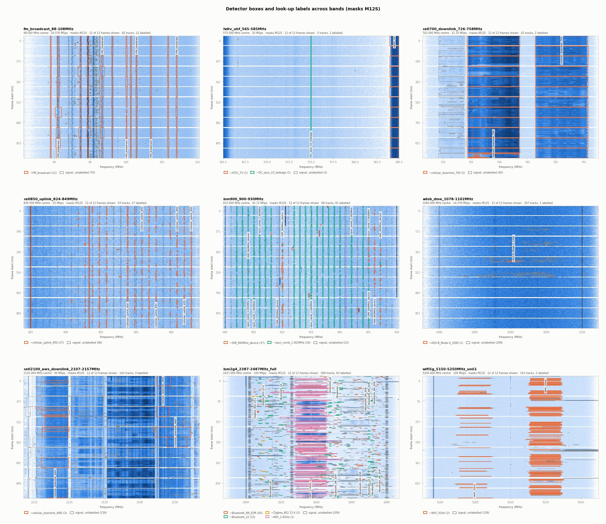
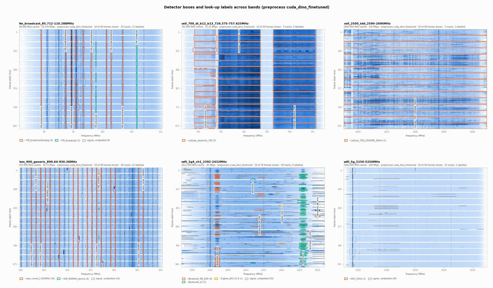

# DataCollectionScripts

Tools to sweep *your* RF environment the way the ARGUS detector was stress-tested, and to attach coarse
estimated labels to what the detector finds. The detector itself lives in
[Holohub-Signal-Detection](https://github.com/Trudes808/Holohub-Signal-Detection)
(`applications/usrp_wideband_signal_detection/README.md`); nothing here depends on it except the output
format of its offline preprocessing (standard SigMF annotations).

| File | Purpose |
|---|---|
| `common_ota_waveforms_manifest_usa.yaml` | The knowledge base: 55 emission types common in the USA (broadcast FM/TV, NOAA, aviation, maritime, land mobile, paging, every cellular block, 900 MHz / 2.4 GHz / 5-6 GHz unlicensed, radar, satellite radio, receiver artefacts) with band, channel raster, bandwidth, temporal behaviour, burst length, spectral shape, confidence tier and default sweep looks. |
| `collect_common_waveforms.py` | Manifest-driven USRP sweep: every entry's centre frequencies x sample rates (46 looks by default, ~11 GB at 1 s each) or any fixed `--freqs` / `--rates` you give it, with an automatic gain probe, SigMF output and provenance in the metadata. |
| `common_waveforms_look_up.py` | Reads detector output (the snippets of `preprocess_dataset.py`, any annotated SigMF, or the mask arrays of the fine-tuning tools), measures each detection (centre, width, duty, persistence, burst length, PSD shape, pilot carriers) and writes `core:label: "~<name>"` when exactly one manifest entry matches with high confidence. Everything else stays `signal`. |
| `plot_look_up_overlays.py` | Figures: each capture as a waterfall with every detector box drawn on it and the estimated label written on the tracked emission; one PNG per capture and an optional montage of several bands (the figure in §3). |
| `manifest_io.py` | Shared helpers: manifest loader (coerces YAML 1.1 numeric strings), the detector's frame geometry per sample rate, USRP master-clock / decimation rate snapping. |
| `n320_stress_matrix/` | The exact scripts used to record the 30-capture N320 stress set (`capture_n320_sigmf.sh`, `capture_n320_matrix.sh`), kept verbatim as the record of how those test files were made. |
| `tests/` | `test_look_up_synthetic.py` (matcher accuracy on synthetic tracks), `evaluate_look_up_on_ota.py` (plausibility scoring on the N320 captures), `test_to_sigmf.py` (converter round trip in every format). Their reports land in `tests/results/`, which is git-ignored and regenerated by the scripts; the summary tables are in §5. |

Requirements: Python 3.10+, numpy, PyYAML, scipy (look-up on mask arrays). The collector needs UHD 4.x
with the `rx_samples_to_file` example (ships with UHD under `<prefix>/lib/uhd/examples/`) or the UHD
Python module. No `sigmf` package is needed; the metadata is plain JSON.

---

## 1. Sweep your environment

```bash
cd DataCollectionScripts
python3 collect_common_waveforms.py --list                      # print the default plan (46 looks)
python3 collect_common_waveforms.py --out ~/captures/site_a \
        --site "roof, Austin TX" --antenna "discone" --author "Your Name"
```

The default plan takes every manifest entry with `sweep.default: true` and captures its centre
frequencies at its sample rates (plus a few explicit off-centre / odd-rate "looks" that reproduce the
stress set, e.g. channel 6 cut at the edge of a 40 MHz look). Options:

| Option | Effect |
|---|---|
| `--entries fm_broadcast,atsc_tv_uhf` | only these entries (ids from the manifest) |
| `--tier A` / `--all` | all tier-A entries / every entry that has sweep centres |
| `--freqs 98e6,881.5e6,2437e6` | fixed centre frequencies; with `--entries` they replace the entries' centres, alone they are captured with the label of whichever entry covers them |
| `--rates 25e6,100e6` | fixed sample rate(s) for every look (replaces the manifest rates) |
| `--dur 0.5`, `--max-gb 1.0` | seconds per capture; size cap that shortens long high-rate captures |
| `--gain auto` (default) / `--gain 40` | 0.2 s probes per look: -15 dB when peak > 0.5 FS, +15 dB when rms < -40 dBFS, up to three steps |
| `--channel 1`, or `--channel-below 1 --channel-above 0 --split-hz 1.5e9` | one RX channel, or one antenna per frequency range (the N320 bench used a VERT900 on ch 1 and a VERT2450 on ch 0) |
| `--args "addr=192.168.10.2"`, `--radio n320` | UHD device args; the radio family is discovered (`uhd.find`) and only used to snap rates to master-clock / decimation values (X4xx: even decimations only, like the detector app) |
| `--survey` | probe the power of every look (0.2 s) and keep no IQ: a quick site survey into `survey_<ts>.csv` |
| `--dry-run`, `--skip-existing`, `--no-shm` | plan only; resume; stream straight to disk instead of `/dev/shm` |

Each capture lands in its own folder, named as the stress set was:

```
<out>/n320_fm_broadcast_85.712-110.288MHz_c98M_r24p576M_g40_ch1/
      n320_fm_broadcast_85.712-110.288MHz_c98M_r24p576M_g40_ch1.sigmf-data   ci16_le interleaved I/Q
      n320_fm_broadcast_85.712-110.288MHz_c98M_r24p576M_g40_ch1.sigmf-meta   SigMF + argus:* provenance
<out>/sweep_<timestamp>.csv / .json / .log                                   one row per capture: gain, peak, rms, overflows, folder
```

`core:description` and the `argus:*` fields record the manifest entry, the look tag, the expected waveforms,
radio / serial / channel / antenna, master clock and decimation, gain, overflow count and the
peak / rms / clipping statistics of the recording, so a capture can always be traced back to how it was made.
Rates are chosen from the radio's achievable set: on an X410 a 200 MSps request becomes 245.76 MSps
(491.52 / 2), on an N320 it stays 200 MSps (master clock 200 MHz).

Do not centre a look on a narrow channel you care about: a zero-IF receiver puts its DC / LO leakage spur
at the capture centre, and the detector flags it (the look-up then names it `~DC_spur_LO_leakage`). The
manifest's default centres sit between channels for that reason.

## 2. Run the detector on the sweep

The detector runs from the Holohub repository (container-based; see its README §1 for the one-time build and
§3 for offline preprocessing):

```bash
cd Holohub-Signal-Detection/applications/usrp_wideband_signal_detection
sudo python3 preprocess_dataset.py ~/captures/site_a --recursive --detector cuda_dino_finetuned
#   -> ~/captures/site_a_preprocessed/<capture>/snippets/*.sigmf-{data,meta} + manifest.csv
```

`--detector coherent_power` (energy detector) and `--detector cuda_dino` (zero-shot) work the same way. To
watch the detector live on the radio instead, use its `run_live_demo.sh` (README §2).

## 3. Estimated labels: `common_waveforms_look_up.py`

```bash
python3 common_waveforms_look_up.py ~/captures/site_a_preprocessed          # labels written into the snippets
python3 common_waveforms_look_up.py ~/captures/site_a_preprocessed --no-write   # report only
python3 common_waveforms_look_up.py <capture>.sigmf-meta                    # any SigMF with annotations
python3 common_waveforms_look_up.py <capture folder> --masks M12S           # masks/M12S.npz from run_ota_detections.py
```

What it does, per capture:

1. **Regions**: every annotation (`core:freq_lower_edge` / `upper_edge`, time from `wfgt:orig_sample_start`
   / `count`, frame number) becomes a region; mask arrays are turned into regions by connected components.
2. **Tracks**: regions are grouped across frames by band overlap; short-lived slivers at the edges of a
   continuous carrier (mask flicker) are absorbed into that carrier. A track knows its centre, width,
   duty (fraction of a 21 ms frame it occupies), persistence (fraction of frames it appears in), burst
   length and whether it touches the capture edge.
3. **IQ features** (when the recording is at hand): a Welch PSD of the box gives the SNR, flatness, crest
   factor, 99 % occupied width and power centroid of the emission (precise to a few kHz where the mask is
   quantised to one bin), whether it is a spectral line, and pilot carriers at the positions a channel grid
   prescribes (ATSC: lower channel edge + 309.441 kHz).
4. **Scoring** against every manifest entry whose band contains the track: bandwidth (with the quantisation
   of the mask taken into account), temporal class (continuous / tdd / bursty / sporadic), burst length,
   channel raster or channel plan (only when the capture's frequency resolution can tell), spectral shape,
   merged adjacent channels (TV), boxes cut by the capture edge, a weak prior against non-exclusive bands.
   Every test leaves a line of evidence in the output.
5. **Decision**: the best entry must pass its tier threshold (A 0.75, B 0.85), have every feature it
   `requires` positively verified (not merely unresolvable), and beat every other candidate by a margin;
   generic entries (`catch_all`) yield to specific ones in the same band. A cross-track pass labels regular
   combs of narrow persistent lines as `~spur_comb_<spacing>MHz` (receiver reference harmonics), and a narrow
   continuous line at the capture centre as `~DC_spur_LO_leakage`.
6. **Output**: `lookup_regions.csv` (one row per track with every measurement, the label, confidence and
   evidence) and `lookup_summary.json`. Unless `--no-write`, each snippet annotation gets
   `core:label = "~<label>"` (the detector's own label is kept in `argus:detector_label`, with
   `argus:estimate_entry`, `argus:estimate_confidence`, `argus:estimate_evidence`), and the `label` column
   of `manifest.csv` is refreshed. Unmatched regions are labelled `signal`.

The `~` marks an estimate. Labels are the manifest `label` field, e.g. `~FM_broadcast`, `~ATSC_TV`,
`~cellular_downlink_850`, `~WiFi_2.4GHz`, `~Bluetooth_LE`, `~ADS-B_Mode-S_1090`, `~Pager_FLEX_POCSAG_929`,
`~ISM_900MHz_device` (deliberately coarse), `~spur_comb_1.002MHz`.

What is **not** labelled, by design: anything outside its normal band, off its channel grid when the grid
can be checked, wider than its service allows (two merged FM stations, a painted-over area), ambiguous
between two services (a 1.4 MHz burst that fits Bluetooth BR and BLE equally), below the tier threshold,
drones and video links, hoppers in quiet bands, and every tier-C entry (GPS, microwave ovens). Those stay
`signal`, exactly as the detector emitted them.

### Seeing the result: `plot_look_up_overlays.py`

```bash
python3 plot_look_up_overlays.py ~/captures/site_a_preprocessed                    # one PNG per capture -> lookup_overlays/
python3 plot_look_up_overlays.py ~/captures/site_a_preprocessed --written-labels   # draw the labels already stored in the snippets
python3 plot_look_up_overlays.py <folder of captures> --masks M12S --select fm_broadcast hdtv_uhf --montage bands.jpg
```

Each panel is one capture: frequency across the page, the detector's frames stacked down it (only the frames the
detector ran; a thin gap marks skipped frames), the waterfall in one hue (darker = stronger), every detected region
as a thin box, and the look-up's label written on up to six tracks per label (the box colour and the legend
identify the rest; `--texts-per-label` changes the six). Gray boxes without text are detections that stayed
`signal`. The look-up runs again on the regions so the figure always reflects the current manifest, unless
`--written-labels` asks for the labels already stored in the annotations. Figures go to `lookup_overlays/` next to
the input (git-ignored) unless `--out` is given; `--montage` tiles the selected captures into one file, in the
order of the `--select` patterns.



*Nine of the N320 stress captures with M12-S masks, ordered by frequency: FM broadcast (12 stations labelled), the
ATSC channel cut by the capture edge, identified by its pilot, next to the receiver's DC spur; two 700 MHz downlink
blocks; 850 MHz uplink bursts (27 tracks); the 900 MHz ISM band with the receiver's 1.002 MHz spur comb (24 lines)
and 37 short device bursts; one ADS-B reply among 266 unlabelled small detections; three AWS downlink carriers;
the 2.4 GHz band (45 Bluetooth BR/EDR and 15 LE hops, 2 Zigbee packets, one Wi-Fi channel); two Wi-Fi channels in
UNII-1. Every gray box is a detection the look-up left as `signal`.*

## 4. The manifest

Each entry is a small physical-layer fact sheet. The keys that drive the look-up:

```yaml
- id: fm_broadcast                       # used in evidence / argus:estimate_entry
  label: FM_broadcast                    # -> "~FM_broadcast"
  tier: A                                # A: label on a confident match; B: stricter; C: never (informational)
  freq_ranges_hz: [[87.8e6, 108.0e6]]    # where it may be (absolute RF)
  raster: {spacing_hz: 200.0e3, offset_hz: 87.9e6}   # or channel_centers_hz: [...]; channel_tolerance_hz
  bandwidth_hz: {min: 120.0e3, nominal: 200.0e3, max: 460.0e3}   # occupied width a detector box shows
  bandwidth_sets_hz: [[14e6, 22e6], [34e6, 42e6]]    # optional: discrete channel widths (Wi-Fi)
  temporal: continuous                   # continuous | bursty | either | tdd
  burst_s: {min: 30.0e-6, max: 10.0e-3}  # one burst (bursty / tdd / either)
  iq_signature: any                      # flat_top | flat_top_pilot | peaked | pulsed | chirp | any
  pilot_grids: [...]                     # pilot carriers on a channel grid (ATSC)
  raster_multiples: 6                    # adjacent channels merged into one box are accepted (TV)
  band_exclusive: true                   # nothing else is normally on the air in freq_ranges_hz
  requires: [bandwidth, temporal]        # features that must be positively verified before a label
  catch_all: true / parent: <id>         # generic entry in a band / the generic entry a specific one falls back to
  sweep: {default: true, centers_hz: [98.0e6], rates_hz: [24.576e6, 50.0e6], looks: [{fc_hz: 103.0e6, rate_hz: 10.0e6, tag: upper_half}], gain_start_db: 40, antenna_group: low}
```

Write floats with a decimal point (`98.0e6`); PyYAML would read `98e6` as a string (the loader coerces it,
but be kind to other readers). `python3 common_waveforms_look_up.py --check-manifest` validates the file.
Adding a regional or private waveform is one more entry; keep it tier B until it has been seen labelled
correctly on real captures.

## 5. How accurate is the look-up?

Two tests; their reports are written to `tests/results/` (git-ignored, regenerated by the scripts):

**Synthetic matcher test** (`tests/test_look_up_synthetic.py`, no detector, no IQ): for each labelable
entry, 120 tracks that obey its physics, quantised to a random capture rate between 5 and 245.76 MSps, plus
120 negatives that violate exactly one property (off band, off grid, 2.5x width, wrong temporal class) and
480 "unusual" emitters (off-grid drone OFDM at 2.4 GHz, a hopper in a quiet band, 40 MHz OFDM at 5.9 GHz, a
continuous 2 MHz carrier at 1.5 GHz).

| measure (51 entries x 120 draws, seed 1) | result |
|---|---|
| positives given the exact label | 71.6 % |
| positives given a wrong label | 0.4 % (mostly AIS -> Marine_VHF, i.e. the coarser maritime label) |
| single-violation negatives still labelled as the violated entry | 14.1 % (see below) |
| unusual emitters labelled (480 draws) | 0 |

Per-entry rows: `tests/test_look_up_synthetic.py` writes `tests/results/synthetic_lookup_eval.md`. Broadcast FM / TV, cellular blocks, DECT,
ADS-B, DME, radar and Iridium score 0.8-0.98; Wi-Fi 0.6-0.75 (bonded channels cut by the random capture
window); narrow voice channels, pagers, AIS and 433/315 MHz remotes 0.1-0.7, because at coarse capture
rates a 12 kHz channel is a one-bin box whose raster cannot be checked, so the look-up only labels it when
the band alone identifies the service. The accepted negatives are almost all of two benign kinds: 2.5x
"merged" widths that are still legal for the entry (a two-carrier cellular downlink is still a downlink),
and off-grid centres at capture rates where the grid is unresolvable, inside exclusive bands.

**N320 OTA stress captures** (`tests/evaluate_look_up_on_ota.py`): the 30 captures of the detector stress
set (FM, TV, cellular up/downlinks, 900 MHz ISM, 2.4 / 5 GHz, ADS-B, a quiet band; 10-200 MSps), using the
masks of three fine-tuned detector models. Each label is checked for plausibility against the capture's span
(an FM label inside 88-108 MHz is consistent, inside 2.4 GHz it is not).

| detector masks | tracks | labelled | inconsistent with the band | precision | exclusive-band recall* |
|---|---|---|---|---|---|
| M12-S | 4921 | 625 | 0 | 1.000 | 22 / 25 |
| M13-S | 5819 | 619 | 0 | 1.000 | 23 / 25 |
| M7-S | 2215 | 549 | 0 | 1.000 | 27 / 30 |

\* continuous tracks of the right width inside an exclusive band (FM, TV, cellular downlink) that received
that band's label. Labels produced: FM stations (11 of 13 continuous FM-width tracks in the 88-108 MHz
look, all on the 200 kHz raster to within a few kHz once the PSD centroid is used), the 850 / 700 / AWS
downlink blocks (including the block that fills the whole 869-894 MHz capture and a 9.5 MHz carrier cut by
the capture edge), ATSC channels identified by their 8-VSB pilots (one of them cut by the capture edge,
one a three-channel merged block), uplink bursts in the 850 / 700 MHz uplink bands, ADS-B replies,
Bluetooth BR/EDR and LE hops and Zigbee packets on their channel grids, Wi-Fi channels 11 and 36, 900 MHz
ISM devices, and the receiver's 1.002 MHz spur comb (27 lines) and DC spur. Nothing was labelled in the
quiet 1338-1362 MHz reference capture or in the two TV captures where the detector paints wide areas
(M12-S's 41 % fill at 499-531 MHz yields one ATSC label, on the real three-channel block with pilots).
Per-capture rows: `tests/evaluate_look_up_on_ota.py` writes `tests/results/ota_lookup_eval.md`.

Read the two together: the look-up almost never labels something as a service that cannot be there, and it
labels most strong, well-formed emissions in exclusive bands; it stays silent on weak or fragmented
detections, on narrow channels captured at coarse rates, and on everything ambiguous. The detector's
own behaviour sets the ceiling: a carrier the detector paints in fragments or drops in half the frames
cannot be labelled with confidence, and that is the intended outcome.

## 6. The N320 stress-matrix scripts

`n320_stress_matrix/capture_n320_sigmf.sh` records one SigMF snippet (`rx_samples_to_file` to `/dev/shm`,
ci16, metadata with the band label and the recording statistics); `capture_n320_matrix.sh` calls it for the
30 looks of the stress set with a per-band gain probe. They are specific to that bench (device address,
serial, antenna assignment, author) and are kept as the record of how the published test captures were made;
`collect_common_waveforms.py` generalises them.

## 7. ELINT-style classification (branch `lut_classification_experiment`)

The look-up of §3 identifies emissions by band, box width and coarse timing. This branch adds the systematic
version: a **library** of physical-layer descriptors taken from the open standards, a **measurement** step
that extracts a signal descriptor word (SDW) from the IQ of every detected emission, and a **matcher** that
scores the SDW against the library field by field. The design notes are in
`notes/lut_classification_experiment_plan.md`, the results in `notes/lut_experiment_results.md`.

| file | role |
|---|---|
| `lut_library_usa.yaml` | Descriptor layer on top of the manifest: for each entry the modulation class, symbol / chip rate, modulation index, deviation, OFDM subcarrier spacing and cyclic prefix, chirp parameters, pulse width, burst length, intervals, gaps, frame / beacon periods, pulse pairs, duty, carrier line, demodulated tones, HD sidebands and hopping, each with a tolerance and the standard it comes from (`source`). Entries new to the library (UAT 978, VDL Mode 2, ATSC 3.0, amateur bands, MURS, WMTS, radiosondes, WCS, LAA, Inmarsat, Globalstar, TDWR, radio altimeters, FPV video, drones, 300-400 MHz remotes, HF broadcasting, VHF satellites) are defined here in full. `variants` describe sub-types (P25 / DMR / NXDN / analogue, LTE 15 kHz / NR 30 kHz, DSSS / OFDM / HE Wi-Fi, BLE 1M / 2M, VOR / ILS). `manifest_io.load_library()` merges the two files. |
| `measure_descriptors.py` | The SDW: band extraction (overlap-save FFT, 2.5x the box for spectral work, 1.15x for everything from the instantaneous frequency), on/off envelope at a fine (pulse) and a coarse (packet) scale with 50 % edge refinement, consecutive-interval and gap histograms, interval peaks per burst-duration class, envelope-autocorrelation periods, OFDM cyclic-prefix correlation (Tu, then Ts and CP from the metric's periodicity), symbol-rate lines of |y|², y², y⁴ and of the frequency transitions, envelope statistics corrected for SNR, instantaneous-frequency levels and deviation, chirp slope, carrier line, band-edge steepness, FM- and AM-demodulated tones, NRSC-5 sidebands, and a band-level pass over all bursts of a capture (hop rate, SIFS+ACK pairs, BLE advertising triplets). |
| `lut_classify.py` | The matcher: the v1 score x descriptor memberships. Every field is verified (measured and matching), contradicting (measured and not matching, a penalty) or unmeasured (neutral); the confidence is `1 - (1 - v1 x penalty) x (1 - verified share)`, so a strongly verified descriptor lifts a weak band score and a contradiction sinks a strong one. Labels need the tier threshold, the manifest `requires` features, `requires_descriptors` verified fields (one in shared bands) and a margin over the runner-up; a verified descriptor breaks ties against unverified competitors. Variants refine the label (`~Narrowband_VHF_150-174/P25`). Writes `lut_regions.csv`, `lut_summary.json`, `sdw_<capture>.json` and, like v1, the labels into the SigMF annotations plus `argus:sdw`. |
| `synth_lut_scenes.py`, `synth_modulators.py` | Synthetic captures for every entry with a `synth` recipe, generated from the entry's own descriptor (CPM/GFSK, FM stereo multiplex with pilot/RDS/HD sidebands, AM, OFDM with any numerology and TDD pattern, SC-FDMA bursts, 8-VSB with pilot, PPM/pulse trains, DME pairs, radar scans, LoRa chirps, O-QPSK, Barker DSSS, OOK, magnetrons) at a legal channel, a sweep sample rate and a random SNR, with the ground-truth boxes written as annotations. |
| `tests/test_measure_synthetic.py` | Unit test of the measurement: 17 emissions with known parameters (BLE, Wi-Fi, LTE, NR TDD, FM, FM+HD, NBFM, AM, VOR, C4FM, POCSAG, DECT, ADS-B, DME, LoRa, 8-VSB, Zigbee). |
| `tests/test_lut_synthetic.py` | End-to-end on synthetic captures: label outcome and verified fields per entry (`tests/results/lut_synthetic_eval.md`, `lut_synthetic_rows.csv`). |
| `tests/evaluate_lut_on_captures.py` | Real captures: plausibility of every label against the capture span, share of labels with verified descriptors, and the measured-parameter distributions per label next to the synthetic ones (`tests/results/lut_real_eval.md`). |

```bash
python3 lut_classify.py ~/captures/site_a_preprocessed                          # SDW + library match, labels written
python3 lut_classify.py <folder of capture folders> --masks M12S --no-write      # stress set from mask arrays
python3 measure_descriptors.py <capture>.sigmf-meta --out sdw.json               # SDWs only
python3 synth_lut_scenes.py --out /tmp/lut_synth --draws 3                       # one capture per entry and draw
python3 tests/test_lut_synthetic.py --out /tmp/lut_synth --draws 3               # generate + classify + score
python3 tests/evaluate_lut_on_captures.py --report ~/captures/site_a_preprocessed
python3 collect_common_waveforms.py --library lut_library_usa.yaml --entries uat_978,dect_6_0 ...   # looks for library-only entries
```



*Six looks of the TX/RX sweep with the M12-S detector boxes and the labels `lut_classify.py` wrote into the annotations
(`plot_look_up_overlays.py --written-labels`): FM stations with the 19 kHz pilot verified (`/analog`), two LTE 700 MHz
downlink blocks (15 kHz subcarriers, 4.7 us CP), the n41 carrier (30 kHz subcarriers, 5 ms TDD period, `/NR_30kHz`),
the receiver's 1.001 MHz spur comb and 900 MHz ISM devices, Bluetooth BR/EDR and LE and a Zigbee packet at 2.4 GHz,
and a Wi-Fi 5 GHz channel (312.5 kHz subcarriers, 0.8 us CP, SIFS, 102.4 ms beacons).*

Results (2026-11-10, `notes/lut_experiment_results.md`): measurement unit test 17 / 17 emissions at 20-30 dB, 15 / 17 at
12 dB; synthetic end-to-end 166 / 189 captures with the exact label, 0 wrong, 168 of 169 correct labels with verified
evidence; real captures (59 sweep looks + 9 stress captures, 2496 tracks) 602 labels against v1's 515, 489 of them
with a verified physical-layer field, 0 inconsistent with the capture span.

What the SDW adds over v1, by discriminating power: OFDM numerology (Wi-Fi 312.5 kHz / HE 78.125 kHz vs LTE 15 kHz
vs NR 30 kHz vs ATSC 3.0 844 Hz), symbol or chip rates (ATSC 10.762 Msym/s, DECT 1.152, BLE / BT 1, Zigbee 2 Mchip/s,
UAT 1.0417, P25 / DMR 4800, pagers 1600 / 1200), timing structure (BT 625 us slots, DECT 10 ms frames, LTE 1 ms
subframes and 2.5 / 5 ms TDD patterns, Wi-Fi SIFS + ACK, BLE T_IFS, Zigbee turnaround, DME 12 us pairs, ADS-B
0.5 us pulses on a 2 MHz grid, Wi-Fi 102.4 ms beacons, AIS 26.67 ms slots), chirp slopes (LoRa BW² / 2^SF), the
19 kHz stereo pilot and HD sidebands of FM, VOR / ILS tones, modulation class and deviation. A real emission
in the wrong band stays `signal`; a real emission in the right band with a contradicting descriptor (an OFDM
carrier where the library expects GFSK) is pushed below the threshold.
